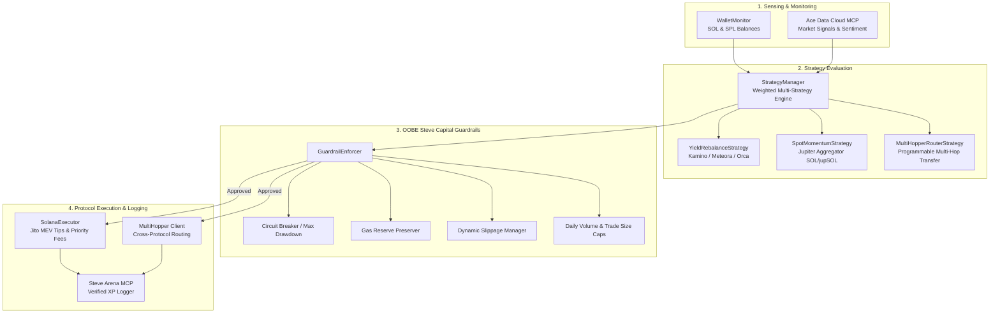

# 🚀 OOBE Autonomous Capital Agent on Solana

[](https://solana.com)
[](https://steve.oobeprotocol.ai)
[](https://multihopper.com)
[](https://platform.acedata.cloud)
[](https://opensource.org/licenses/MIT)
[](https://www.typescriptlang.org/)

An autonomous, multi-strategy capital allocation and liquidity management agent built for **Solana**, powered by **OOBE Protocol (Steve Capital OS)**, and integrated with **MultiHopper Programmable Routing** and **Ace Data Cloud AI Intelligence**.

Developed for the **Superteam Earn Steve Capital Agent Challenge**.

---

## 📑 Table of Contents

- [System Architecture](#-system-architecture)
- [Core Mechanics & Features](#-core-mechanics--features)
  - [1. Autonomous Execution State Machine](#1-autonomous-execution-state-machine)
  - [2. Multi-Strategy Capital Allocation](#2-multi-strategy-capital-allocation)
  - [3. OOBE Guardrails & Programmable Risk Enforcer](#3-oobe-guardrails--programmable-risk-enforcer)
  - [4. Dynamic Slippage & Jito MEV Protection](#4-dynamic-slippage--jito-mev-protection)
  - [5. MultiHopper Programmable Routing Engine](#5-multihopper-programmable-routing-engine)
  - [6. Ace Data Cloud AI Market Intelligence](#6-ace-data-cloud-ai-market-intelligence)
  - [7. Steve Arena Verified XP Activity Logging](#7-steve-arena-verified-xp-activity-logging)
- [Repository Structure](#-repository-structure)
- [Quick Start Guide](#-quick-start-guide)
  - [Prerequisites](#prerequisites)
  - [Installation](#installation)
  - [Generate Agent Wallet](#generate-agent-wallet)
  - [Run Simulation Mode](#run-simulation-mode)
  - [Run Live Mode](#run-live-mode)
- [Environment Configuration](#-environment-configuration)
- [Testing & Quality Assurance](#-testing--quality-assurance)
- [Bounty & Side Track Qualifications](#-bounty--side-track-qualifications)

---

## 🏛 System Architecture

The agent runs an event-driven autonomous execution loop, decoupled into sensing (wallet + market intelligence), strategy evaluation, risk validation through OOBE guardrails, and atomic execution across Solana protocols.



---

## ⚡ Core Mechanics & Features

### 1. Autonomous Execution State Machine
The agent operates via a strictly typed finite state machine:
- `INITIALIZING`: Bootstraps keypair, RPC connections, and registers with Steve Capital MCP.
- `IDLE`: Awaiting trigger timer or market events.
- `MONITORING`: Evaluates real-time wallet balances, gas reserves, and asset valuations.
- `EVALUATING`: Generates strategy signals based on conviction and market sentiment.
- `GUARDRAIL_CHECK`: Validates proposed actions against OOBE Protocol risk parameters.
- `EXECUTING`: Submits transactions via Jupiter, MultiHopper, or liquidity pools with Jito MEV protection.
- `REBALANCING`: Reallocates portfolio weights back to target distributions.
- `COOLDOWN`: Enforces rate limits and waits for next cycle tick.
- `EMERGENCY_STOP`: Irreversible halt triggered if max drawdown circuit breaker trips.

### 2. Multi-Strategy Capital Allocation
1. **YieldRebalanceStrategy**: Monitors yield differentials across Kamino Lend, Meteora DLMM dynamic pools, and Orca Whirlpools. Automatically rebalances idle stables into the highest APY pool when spreads exceed thresholds.
2. **SpotMomentumStrategy**: Uses Ace Data Cloud sentiment indicators to adjust exposure between pure SOL, liquid staking tokens (`jupSOL`, `bSOL`), and USDC.
3. **MultiHopperRouterStrategy**: Routes capital through multi-hop liquidity paths to minimize price impact and capture routing efficiencies.

### 3. OOBE Guardrails & Programmable Risk Enforcer
All executions must pass through the `GuardrailEnforcer` before transaction submission:
- **Max Allocation Per Trade**: Enforces a strict ceiling per transaction (e.g. $50 max).
- **Max Daily Volume**: Limits aggregate daily turnover to prevent runaway loops.
- **Gas Reserve Preserver**: Ensures a hard minimum of SOL (e.g., 0.05 SOL) is permanently reserved for network fees.
- **Whitelisted Protocols & Mints**: Rejects any non-whitelisted token or contract interaction.
- **Drawdown Circuit Breaker**: Halts operations if portfolio peak-to-trough decline exceeds 10%.

### 4. Dynamic Slippage & Jito MEV Protection
- **Volatility-Adjusted Slippage**: Dynamically calculates slippage tolerance using estimated pool price impact and market volatility index.
- **Jito Bundle Tips**: Integrates Jito tip accounts and priority fee calculations to defend against sandwich attacks and front-running on volatile swaps.

### 5. MultiHopper Programmable Routing Engine
- Supports programmable multi-hop transfers and cross-venue liquidity routing.
- Records verifiable route signatures and USD principal volume for the MultiHopper partner side-track.

### 6. Ace Data Cloud AI Market Intelligence
- Connects to Ace MCP to ingest Google Search trends, macro market sentiment, and volatility metrics to provide qualitative conviction weighting for quantitative strategies.

### 7. Steve Arena Verified XP Activity Logging
- Every autonomous execution generates a structured action event conforming to Steve Capital MCP specifications, logging transaction signatures, protocol identifiers, and USD values for verified Arena XP.

---

## 📂 Repository Structure

```
oobe-capital-agent/
├── src/
│   ├── index.ts                     # CLI entrypoint & process lifecycle manager
│   ├── agent/
│   │   ├── CapitalAgent.ts          # Core autonomous orchestrator
│   │   ├── StateMachine.ts          # Finite state machine & emergency halt
│   │   ├── WalletMonitor.ts         # Multi-token wallet balance & valuation tracker
│   │   └── Memory.ts                # Action ledger & cumulative PnL tracking
│   ├── config/
│   │   ├── index.ts                 # Zod environment schema & validator
│   │   └── guardrails.ts            # OOBE Protocol default limits & whitelists
│   ├── execution/
│   │   ├── SolanaExecutor.ts        # Transaction simulation & broadcast engine
│   │   ├── SlippageManager.ts       # Dynamic slippage calculation
│   │   └── JitoProtection.ts        # Priority fees & Jito bundle MEV tips
│   ├── protocols/
│   │   ├── oobe/
│   │   │   ├── SteveMcpClient.ts    # Steve Capital MCP runtime & Arena XP
│   │   │   └── GuardrailEnforcer.ts # Risk parameters & circuit breakers
│   │   ├── jupiter/
│   │   │   └── JupiterClient.ts     # Jupiter v6 aggregator client
│   │   ├── multihopper/
│   │   │   └── MultiHopperClient.ts # MultiHopper routing engine
│   │   └── acedata/
│   │       └── AceMarketIntelligence.ts # Ace Data Cloud AI search & sentiment
│   ├── strategies/
│   │   ├── types.ts                 # Strategy interfaces & signal schemas
│   │   ├── StrategyManager.ts       # Weighted multi-strategy evaluator
│   │   ├── YieldRebalanceStrategy.ts# Kamino/Meteora/Orca APY optimizer
│   │   ├── SpotMomentumStrategy.ts  # Momentum & trend allocator
│   │   └── MultiHopperRouter.ts     # Programmable routing strategy
│   └── utils/
│       ├── logger.ts                # Structured color-coded logger
│       ├── math.ts                  # Decimal & BPS math helpers
│       └── solana.ts                # Keypair loader & Solana constants
├── scripts/
│   ├── demo-simulation.ts           # Interactive multi-step walkthrough simulation
│   └── generate-wallet.ts           # Agent wallet generator utility
├── tests/
│   ├── unit/                        # Unit tests for StateMachine, Guardrails, Slippage, etc.
│   └── integration/                 # End-to-end autonomous loop tests
├── package.json
├── tsconfig.json
└── vitest.config.ts
```

---

## 🛠 Quick Start Guide

### Prerequisites
- [Node.js](https://nodejs.org/) v20.0.0 or higher
- [npm](https://www.npmjs.com/) v10.0.0 or higher

### Installation

```bash
# Clone the repository
git clone https://github.com/zhoujie0420/oobe-capital-agent.git
cd oobe-capital-agent

# Install dependencies
npm install

# Copy environment template
cp .env.example .env
```

### Generate Agent Wallet

To create a fresh dedicated Solana keypair for your autonomous agent:

```bash
npm run generate-wallet
```

Output:
```text
================================================================================
             NEW OOBE SOLANA CAPITAL AGENT WALLET GENERATED                     
================================================================================
Public Key (Deposit Address): CFpbDCqXvP7Jj5NfAGDWaKdPnHFW6y2gojnnPNFfkvAS
Private Key (Base58 Secret):  4Wfvj4ta8nUXHC8MpQ1VFE9K3XCRrUZdpwUoBwVkV...
--------------------------------------------------------------------------------
To activate your autonomous agent for the Steve Capital Challenge:
1. Add the private key to your .env file: AGENT_PRIVATE_KEY=<key>
2. Fund the wallet with at least 20 USDC and 0.05 SOL (for gas reserve).
3. Register and monitor your agent on Steve Arena: https://steve.oobeprotocol.ai
================================================================================
```

### Run Simulation Mode (Zero Risk Dry-Run)

Simulate complete autonomous cycles with market signals, strategy evaluation, guardrails validation, and simulated transactions:

```bash
npm run simulate
```

### Run Live Mode

1. Fund your agent wallet with at least **20 USDC** and **0.05 SOL** (on Solana mainnet).
2. Set `EXECUTION_MODE=live` and your `AGENT_PRIVATE_KEY` in `.env`.
3. Launch the daemon:

```bash
npm start
```

---

## ⚙ Environment Configuration

| Variable | Default | Description |
|---|---|---|
| `SOLANA_NETWORK` | `mainnet-beta` | Target Solana cluster (`mainnet-beta`, `devnet`) |
| `SOLANA_RPC_URL` | `https://api.mainnet-beta.solana.com` | Solana JSON-RPC endpoint |
| `AGENT_PRIVATE_KEY` | *(empty)* | Base58 encoded secret key or path to keypair JSON |
| `EXECUTION_MODE` | `simulation` | `simulation` (dry-run) or `live` (on-chain broadcast) |
| `POLL_INTERVAL_MS` | `15000` | Loop interval in milliseconds (default: 15s) |
| `MAX_ALLOCATION_PER_TRADE_USD` | `50.0` | OOBE Guardrail: max USD allowed per single execution |
| `MAX_DAILY_VOLUME_USD` | `500.0` | OOBE Guardrail: maximum daily aggregate USD volume |
| `MIN_SOL_RESERVE_GAS` | `0.05` | Minimum SOL balance preserved for transaction fees |
| `MAX_SLIPPAGE_BPS` | `50` | Maximum slippage in basis points (50 = 0.5%) |
| `CIRCUIT_BREAKER_MAX_DRAWDOWN_PCT` | `10.0` | Maximum portfolio drawdown triggering emergency halt |
| `STEVE_MCP_ENDPOINT` | `https://steve.oobeprotocol.ai/mcp` | OOBE Steve Capital MCP runtime endpoint |
| `MULTI_HOPPER_ENABLED` | `true` | Enable MultiHopper programmable routing |
| `MULTI_HOPPER_API_URL` | `https://api.multihopper.com/v1` | MultiHopper API endpoint |
| `ACE_DATA_CLOUD_API_KEY` | *(optional)* | Ace Data Cloud API Key for AI market intelligence |

---

## 🧪 Testing & Quality Assurance

The codebase includes comprehensive unit tests and integration tests covering the state machine, risk guardrails, slippage bounds, and the end-to-end autonomous loop:

```bash
# Run test suite
npm test
```

### Test Coverage Highlights:
- ✅ **StateMachine**: Validates transitions, listener dispatch, and irrevocable emergency shutdown.
- ✅ **GuardrailEnforcer**: Tests single allocation ceilings, daily volume accumulation, protocol whitelisting, gas reserves, and drawdown triggers.
- ✅ **SlippageManager**: Tests dynamic slippage escalation under high volatility and bounds enforcement.
- ✅ **YieldRebalanceStrategy**: Tests yield differential calculation across Kamino, Meteora DLMM, and Orca.
- ✅ **MultiHopperRouter**: Tests programmable multi-hop signal generation.
- ✅ **AutonomousLoop Integration**: Verifies end-to-end sensing -> evaluation -> guardrails -> execution -> Steve Arena logging.

---

## 🏆 Bounty & Side Track Qualifications

### Main Track: OOBE Protocol / Steve Capital OS
- **Autonomous Agent**: Production-ready autonomous execution loop with configurable conviction thresholds.
- **Guardrails & Risk Controls**: Programmable limits for daily volume, single trade size, minimum gas, and circuit breakers.
- **Ecosystem Tool Coverage**: Integrates Kamino, Meteora DLMM, Orca, Jupiter v6, and Steve Arena XP event recording.

### Side Track 1: MultiHopper Programmable Routing
- **Routing Engine**: Full integration via `MultiHopperClient` supporting multi-hop paths (USDC -> Kamino LP / bSOL / JupSOL).
- **Verified Routing Volume**: Tracks cumulative routed principal and hop signatures.

### Side Track 2: Ace Data Cloud AI Market Intelligence
- **AI Integration**: Ingests sentiment, volatility indices, and target asset allocation weights via `AceMarketIntelligence` to inform autonomous agent conviction.

---

## 📄 License

This project is licensed under the [MIT License](LICENSE).
